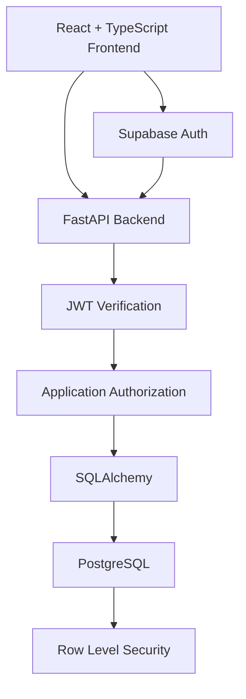

# HACKPRENEUR

<p align="center">
  <strong>From Hackathon Prototype to Real-World Product.</strong>
  <br />
  Build. Collaborate. Continue.
</p>

<p align="center">
  <a href="https://github.com/Adityadevhare/hackpreneur">
    
  </a>
  
  
  
</p>

---

## The Idea

**A hackathon should not be the end of a project. It should be the beginning.**

Hackathons bring together ambitious people, creative ideas, and promising prototypes. But once the event ends, teams often struggle to maintain momentum, find collaborators, access mentorship, and turn their prototypes into sustainable products.

HACKPRENEUR aims to bridge that gap.

It is being developed as a collaborative platform where participants can discover opportunities, build teams, manage projects, connect with mentors, and continue working beyond the event.

## The Three Pillars

<table>
  <tr>
    <td width="33%" valign="top">
      <h3>Connect</h3>
      Discover participants, teams, hackathons, mentors, and opportunities.
    </td>
    <td width="33%" valign="top">
      <h3>Collaborate</h3>
      Build projects, coordinate with teammates, and share work with authorized collaborators.
    </td>
    <td width="33%" valign="top">
      <h3>Continue</h3>
      Preserve project ownership, relationships, and progress beyond hackathon deadlines.
    </td>
  </tr>
</table>

## What We're Building

HACKPRENEUR is being developed around a set of connected capabilities:

- **Project Management** — Create and manage projects with individual or team ownership.
- **Team Collaboration** — Support team membership, administration, and delegated permissions.
- **Project Visibility** — Public, unlisted, and private project access.
- **Ownership Management** — Preserve creator attribution and support ownership transitions.
- **Role-Based Access** — Separate platform roles, event assignments, and project permissions.
- **Secure Authentication** — Authenticated access using Supabase Auth and backend JWT verification.
- **GitHub Integration** — Planned repository connectivity through a GitHub App with selected-repository access.

> Features are being developed incrementally. Planned capabilities are not represented as completed functionality.

## Technology Stack

### Frontend

| Technology | Purpose |
|---|---|
| React | User interface |
| TypeScript | Type safety |
| Vite | Development and build tooling |
| CSS | Styling |
| Supabase JS | Authentication client |

### Backend

| Technology | Purpose |
|---|---|
| Python | Backend language |
| FastAPI | REST API |
| SQLAlchemy | Database ORM |
| Alembic | Database migrations |
| Pydantic | Data validation |
| HTTPX | HTTP client |
| Cryptography | Security-related cryptographic operations |

### Database & Infrastructure

| Technology | Purpose |
|---|---|
| Supabase PostgreSQL | Primary database |
| Supabase Auth | Authentication |
| PostgreSQL RLS | Database-level access control |
| JWT / JWKS | Backend token verification |
| Fernet | Planned encrypted credential storage for integrations |

## Architecture

The platform separates authentication, application authorization, and database access control.



### Security Principles

Security is part of the architecture, not an afterthought.

- Verify Supabase-issued JWTs on the backend.
- Keep authorization decisions on the server.
- Separate platform roles from authentication-provider roles.
- Enforce ownership and permissions at the application and database levels.
- Use transaction-local user context for PostgreSQL RLS.
- Keep privileged database credentials separate from runtime database access.
- Apply least-privilege access to project and integration permissions.

## Current Implementation

The project is under active development.

| Area | Status |
|---|---|
| Authentication foundation | Implemented |
| Frontend authentication integration | Implemented |
| Backend JWT verification | Implemented |
| PostgreSQL integration | Implemented |
| Project ownership model | Implemented |
| Project visibility controls | Implemented |
| Project soft deletion and restoration | Implemented |
| PostgreSQL RLS for projects | Implemented |
| Authenticated frontend project API integration | Implemented |
| GitHub App integration | Planned |
| Team collaboration workflows | Planned |
| Event and mentor workflows | Planned |
| AI-assisted project capabilities | Planned |

Implementation status reflects the current development milestones and may change as the codebase evolves.

## Repository Structure

```text
hackpreneur/
├── backend/
│   ├── Authentication and API logic
│   ├── Database models and configuration
│   ├── Database migrations
│   └── Tests
│
├── frontend/
│   ├── React application
│   ├── Components and pages
│   └── API and authentication integration
│
└── README.md
```

## Getting Started

### Prerequisites

- Python 3.10+
- Node.js and npm
- A Supabase project with PostgreSQL
- Git

### 1. Clone the repository

```bash
git clone https://github.com/Adityadevhare/hackpreneur.git
cd hackpreneur
```

### 2. Configure the environment

Configure the backend and frontend environment variables using the project's environment templates and configuration.

Keep credentials, database passwords, signing keys, and other secrets out of source control.

### 3. Start the backend

Follow the backend dependency and environment setup, then start the FastAPI application using its configured ASGI entry point.

The interactive API documentation is available at:

```text
http://127.0.0.1:8000/docs
```

### 4. Start the frontend

```bash
cd frontend
npm install
npm run dev
```

Vite will display the local development URL in the terminal.

> Database migrations and environment configuration must be completed before running the application against a new database.

## Development Philosophy

HACKPRENEUR is being built with a few principles in mind:

1. **Security by design** — Access should be explicit, scoped, and auditable.
2. **Ownership matters** — Projects and contributions should not disappear when an event ends.
3. **Modular architecture** — Features should evolve without making the entire platform tightly coupled.
4. **Practical engineering** — Build useful functionality before adding unnecessary complexity.
5. **Long-term thinking** — The platform should support projects beyond the short lifecycle of a hackathon.

## Roadmap

- [x] Authentication foundation
- [x] Secure project backend
- [x] Frontend API integration
- [ ] GitHub App integration
- [ ] Team management and collaboration
- [ ] Hackathon and event workflows
- [ ] Mentor and judge workflows
- [ ] Project evaluation and feedback
- [ ] AI-assisted project development
- [ ] Production deployment and scalability

## Contributing

HACKPRENEUR is currently evolving through active development.

Suggestions, discussions, and constructive feedback are welcome. Please open an issue to discuss a substantial change before submitting a pull request.

## The Bigger Picture

The goal isn't simply to help people participate in more hackathons.

It's to help them do something meaningful with what they build.

**Build. Collaborate. Continue.**

---

<p align="center">
  <strong>HACKPRENEUR</strong>
  <br />
  Turning short-term hackathon energy into long-term innovation.
</p>

<p align="center">
  <a href="https://github.com/Adityadevhare">GitHub</a>
  ·
  <a href="https://github.com/Adityadevhare/hackpreneur">Repository</a>
</p>
